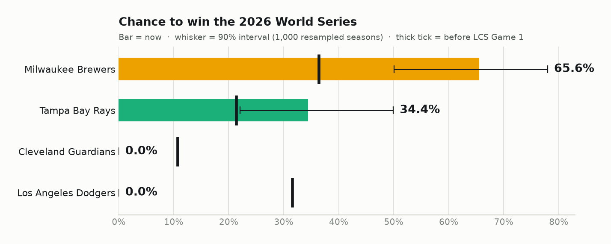
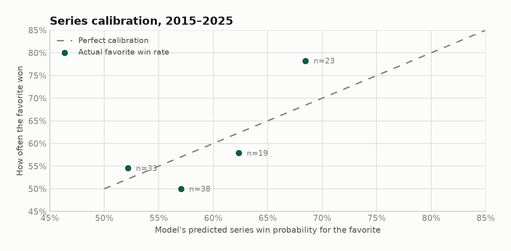
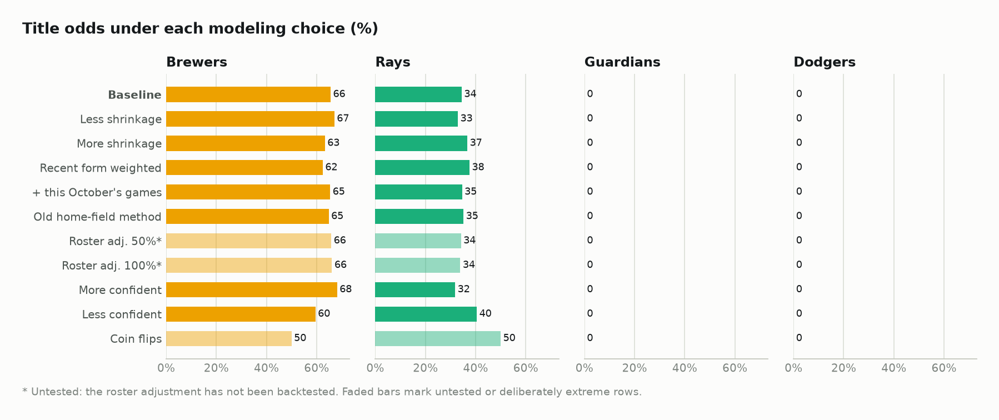
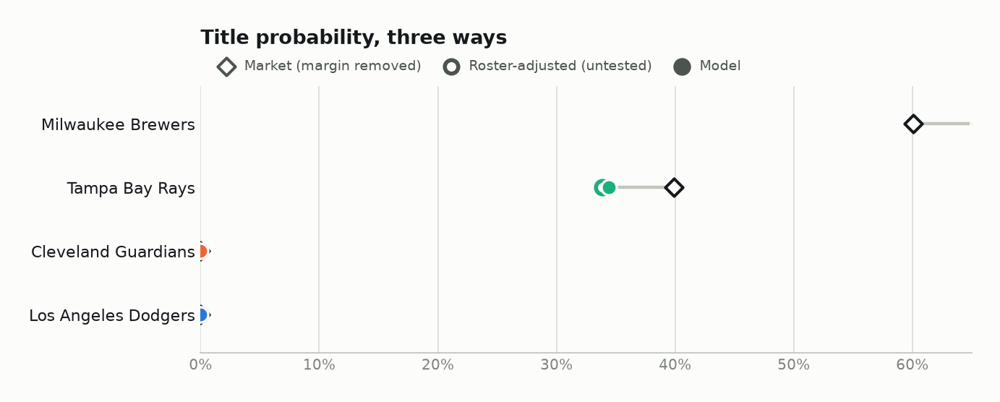

# 2026 World Series Forecast

*Forecast as of Oct 19, 2026 games. Static version of the report. The [live dashboard](https://mlb-ws-forecast-w3huajspduv8ae2mctsydr.streamlit.app/) has the same numbers plus a what-if simulator.*

## The pick: Milwaukee Brewers, 66%

|  |  |
| --- | ---: |
| Model | **66%** |
| 90% interval (1,000 resampled seasons) | 50%–78% |
| Betting market, margin removed | 60% |
| Most likely World Series | TB vs MIL (100%) |

The Brewers finished 103–59, the best record in baseball. They lead the Dodgers 4–0 in the NLCS and would host Games 1, 2, 6 and 7 of any World Series. Every version of the model makes them the favorite. That still leaves a 34% chance the trophy goes somewhere else. October baseball is mostly noise, and this report shows how much.

## Where the series stand

### AL Championship Series: Rays win 4–2

|  | G1 | G2 | G3 | G4 | G5 | G6 | W |
| --- | :---: | :---: | :---: | :---: | :---: | :---: | :---: |
| **Guardians** | **7** | 1 | **3** | 3 | 1 | 3 | **2** |
| **Rays** | 3 | **3** | 2 | **7** | **3** | **7** | **4** |
| *Home* | *Rays* | *Rays* | *Guardians* | *Guardians* | *Guardians* | *Rays* |  |

### NL Championship Series: Brewers win 4–0

|  | G1 | G2 | G3 | G4 | W |
| --- | :---: | :---: | :---: | :---: | :---: |
| **Dodgers** | 1 | 4 | 2 | 4 | **0** |
| **Brewers** | **2** | **7** | **6** | **6** | **4** |
| *Home* | *Brewers* | *Brewers* | *Dodgers* | *Dodgers* |  |

### World Series: tied 0–0

|  | G1 | G2 | G3 | G4 | G5 | G6 | G7 | W |
| --- | :---: | :---: | :---: | :---: | :---: | :---: | :---: | :---: |
| **Rays** | · | · | · | · | · | · | · | **0** |
| **Brewers** | · | · | · | · | · | · | · | **0** |
| *Home* | *Brewers* | *Brewers* | *Rays* | *Rays* | *Rays* | *Brewers* | *Brewers* |  |

Next: Game 1, 2026-10-23, Rays at Brewers.

## Title odds

Exact probabilities from every remaining path through the bracket, using the real home/away schedule. Since the LCS began, the Brewers moved from 36% to 66% and the Dodgers went from 32% to 0%.

<picture>
  <source media="(prefers-color-scheme: dark)" srcset="figures/odds-dark.png">
  
</picture>

| Team | Title now | 90% interval | Pennant now | Title before LCS | Market |
| --- | ---: | ---: | ---: | ---: | ---: |
| Milwaukee Brewers | **65.6%** | 50%–78% | 100.0% | 36.4% | 60% |
| Tampa Bay Rays | **34.4%** | 22%–50% | 100.0% | 21.3% | 40% |
| Cleveland Guardians | **0.0%** | 0%–0% | 0.0% | 10.7% | 0% |
| Los Angeles Dodgers | **0.0%** | 0%–0% | 0.0% | 31.5% | 0% |

| Possible World Series | Chance it happens | AL team wins | NL team wins | Home field |
| --- | ---: | ---: | ---: | ---: |
| Rays vs Brewers | 100.0% | 34.4% | 65.6% | Brewers (better record) |
| Guardians vs Dodgers | 0.0% | 28.0% | 72.0% | Dodgers (better record) |
| Guardians vs Brewers | 0.0% | 26.2% | 73.8% | Brewers (better record) |
| Rays vs Dodgers | 0.0% | 36.4% | 63.6% | Dodgers (better record) |

## The forecast record

Every forecast is saved before the games it predicts and never changed afterward. Each one is fingerprinted, checked by the test suite and pushed to GitHub with a timestamped tag. The model is frozen; new games only change the bracket situation, and each refresh adds forecasts it can be graded on. Retrospective rows were computed afterward for context and are never scored.

| Forecast | Kind | Made (UTC) | Series state | Before first pitch | Brewers | Rays | Guardians | Dodgers | Code |
| --- | --- | --- | --- | :---: | ---: | ---: | ---: | ---: | --- |
| Before LCS (retro) | retrospective | 2026-10-13 22:32:03 | ALCS 0–0 · NLCS 0–0 | n/a | 36.4% | 21.3% | 10.7% | 31.5% | [17d0d6b](https://github.com/dipgip/mlb-WS-forecast/commit/17d0d6b) |
| Oct 13 · v1 | live | 2026-10-13 18:58:10 | ALCS CLE 1–0 · NLCS MIL 2–0 | ✓ | 57.2% | 15.2% | 15.6% | 12.0% | [5455bc2](https://github.com/dipgip/mlb-WS-forecast/commit/5455bc2) |
| Oct 13 · v2 | live | 2026-10-13 22:32:03 | ALCS CLE 1–0 · NLCS MIL 2–0 | ✓ | 57.4% | 14.9% | 15.2% | 12.5% | [17d0d6b](https://github.com/dipgip/mlb-WS-forecast/commit/17d0d6b) |
| Oct 14 · v2 | live | 2026-10-14 16:10:11 | ALCS 1–1 · NLCS MIL 2–0 | ✓ | 56.5% | 19.9% | 11.4% | 12.3% | [590fdb6](https://github.com/dipgip/mlb-WS-forecast/commit/590fdb6) |
| Oct 15 · v2 | live | 2026-10-15 18:32:43 | ALCS 1–1 · NLCS MIL 3–0 | ✗ | 65.1% | 19.7% | 11.3% | 3.9% | [b91e22b](https://github.com/dipgip/mlb-WS-forecast/commit/b91e22b) |
| Oct 15 · v2 | live | 2026-10-15 20:43:59 | ALCS CLE 2–1 · NLCS MIL 3–0 | ✓ | 66.6% | 13.1% | 16.3% | 4.0% | [30d00d4](https://github.com/dipgip/mlb-WS-forecast/commit/30d00d4) |
| Oct 16 · v2 | live | 2026-10-16 20:10:20 | ALCS CLE 2–1 · NLCS MIL 4–0 | ✓ | 70.7% | 13.1% | 16.2% | 0.0% | [b221bad](https://github.com/dipgip/mlb-WS-forecast/commit/b221bad) |
| Oct 18 · v2 | live | 2026-10-18 16:09:39 | ALCS 2–2 · NLCS MIL 4–0 | ✗ | 69.0% | 19.9% | 11.0% | 0.0% | [51c9dd4](https://github.com/dipgip/mlb-WS-forecast/commit/51c9dd4) |
| Oct 19 · v2 | live | 2026-10-19 16:10:14 | ALCS TB 3–2 · NLCS MIL 4–0 | ✗ | 67.1% | 28.1% | 4.8% | 0.0% | [199cb62](https://github.com/dipgip/mlb-WS-forecast/commit/199cb62) |
| Oct 20 · v2 | live | 2026-10-20 16:09:43 | ALCS TB 4–2 · NLCS MIL 4–0 · WS 0–0 | ✗ | 65.6% | 34.4% | 0.0% | 0.0% | [6cd9078](https://github.com/dipgip/mlb-WS-forecast/commit/6cd9078) |

- **Oct 13 · v1 → Oct 13 · v2:** no new games; model v1 → v2.
- **Oct 13 · v2 → Oct 14 · v2:** ALCS G2: Cleveland Guardians 1, Tampa Bay Rays 3.
- **Oct 14 · v2 → Oct 15 · v2:** NLCS G3: Milwaukee Brewers 6, Los Angeles Dodgers 2.
- **Oct 15 · v2 → Oct 15 · v2:** ALCS G3: Tampa Bay Rays 2, Cleveland Guardians 3; NLCS G4: Milwaukee Brewers 6, Los Angeles Dodgers 4.
- **Oct 15 · v2 → Oct 16 · v2:** no new games.
- **Oct 16 · v2 → Oct 18 · v2:** ALCS G4: Tampa Bay Rays 7, Cleveland Guardians 3.
- **Oct 18 · v2 → Oct 19 · v2:** ALCS G5: Tampa Bay Rays 3, Cleveland Guardians 1.
- **Oct 19 · v2 → Oct 20 · v2:** ALCS G6: Cleveland Guardians 3, Tampa Bay Rays 7.

**Game-by-game forecasts**

| Game | Matchup | First pitch (UTC) | Forecast made (UTC) | Model favorite | Chance | Result |
| --- | --- | --- | --- | --- | ---: | --- |
| ALCS G2 | Cleveland Guardians @ Tampa Bay Rays | 2026-10-14 00:00:00 | 2026-10-13 22:34:05 | Tampa Bay Rays | 57.1% | ✓ Tampa Bay Rays (3–1) |
| ALCS G3 | Tampa Bay Rays @ Cleveland Guardians | 2026-10-15 17:00:00 | 2026-10-14 16:10:12 | Tampa Bay Rays | 51.6% | ✗ Cleveland Guardians (3–2) |
| ALCS G4 | Tampa Bay Rays @ Cleveland Guardians | 2026-10-16 22:00:00 | 2026-10-15 20:44:00 | Tampa Bay Rays | 51.6% | ✓ Tampa Bay Rays (7–3) |
| ALCS G5 | Tampa Bay Rays @ Cleveland Guardians | 2026-10-18 21:08:00 | 2026-10-18 16:09:40 | Tampa Bay Rays | 51.6% | ✓ Tampa Bay Rays (3–1) |
| ALCS G6 | Cleveland Guardians @ Tampa Bay Rays | 2026-10-20 00:08:00 | 2026-10-19 16:10:15 | Tampa Bay Rays | 57.1% | ✓ Tampa Bay Rays (7–3) |
| NLCS G3 | Milwaukee Brewers @ Los Angeles Dodgers | 2026-10-15 00:00:00 | 2026-10-13 22:34:05 | Los Angeles Dodgers | 51.9% | ✗ Milwaukee Brewers (6–2) |
| NLCS G4 | Milwaukee Brewers @ Los Angeles Dodgers | 2026-10-16 00:00:00 | 2026-10-15 18:32:44 | Los Angeles Dodgers | 51.9% | ✗ Milwaukee Brewers (6–4) |
| World Series G1 | Tampa Bay Rays @ Milwaukee Brewers | 2026-10-24 00:00:00 | 2026-10-20 16:09:44 | Milwaukee Brewers | 59.6% | not played yet |

## How I got here

The full log with every number is in [LOG.md](../LOG.md), and a partner review of the weak spots is in [REVIEW.md](../REVIEW.md). The core method was fixed before any 2026 odds were computed.

1. **Pulled every game since 2015.** 28,096 regular-season and postseason results from the official MLB Stats API, plus the live bracket, rosters and announced starters.
2. **Rated every team on runs, not wins.** A Poisson model gives each team an offense and a defense rating, adjusted for opponents and pulled toward average. Home field is set from actual home win rates (53% between equal teams), because run totals understate it.
3. **Tuned it on games it hadn't seen.** Fit through August, predict September, ten seasons over. Heavy shrinkage won, and weighting recent form didn't help.
4. **Graded it on 11 real Octobers.** Every playoff game and series from 2015–2025, each predicted using only that year's regular season. Also tested whether adjusting for each game's starting pitchers helps; it doesn't.
5. **Ran the live bracket.** Each series from its current state, then all four possible World Series, with home field set by MLB's tiebreak rules.
6. **Measured the uncertainty and tried to break it.** 1,000 resampled seasons for the interval, eleven alternative setups, and a comparison against betting markets.

## Can it be trusted? The backtest

The stronger team does not reliably win in October, so the useful question is whether the model's probabilities are honest. When the model's series favorite was predicted to win 59% of the time, favorites actually won 58% across 113 series. With a sample that small, the 95% interval on that win rate is 49%–67%: consistent with good calibration, but not proof of it.

| Measure | Result |
| --- | ---: |
| Series favorites won | 58% of 113 (predicted 59%) |
| Game favorites won | 54.5% of 440 |
| Playoff log loss: model / standings / coin flip (lower is better) | 0.6848 / 0.6893 / 0.6931 |

<picture>
  <source media="(prefers-color-scheme: dark)" srcset="figures/calibration-dark.png">
  
</picture>

Dots show how often the model's series favorite actually won, grouped by how confident the model was. Each bin holds only 19–38 series, so expect scatter around the line.

| World Series | Model favorite | Fav. chance | Winner |  |
| --- | --- | ---: | --- | --- |
| 2015 | Kansas City Royals | 58.7% | Kansas City Royals | ✓ called |
| 2016 | Chicago Cubs | 65.4% | Chicago Cubs | ✓ called |
| 2017 | Los Angeles Dodgers | 50.7% | Houston Astros | ✗ upset |
| 2018 | Boston Red Sox | 50.8% | Boston Red Sox | ✓ called |
| 2019 | Houston Astros | 62.7% | Washington Nationals | ✗ upset |
| 2020 | Los Angeles Dodgers | 68.1% | Los Angeles Dodgers | ✓ called |
| 2021 | Houston Astros | 59.2% | Atlanta Braves | ✗ upset |
| 2022 | Houston Astros | 69.4% | Houston Astros | ✓ called |
| 2023 | Texas Rangers | 68.2% | Texas Rangers | ✓ called |
| 2024 | Los Angeles Dodgers | 52.1% | Los Angeles Dodgers | ✓ called |
| 2025 | Los Angeles Dodgers | 52.9% | Los Angeles Dodgers | ✓ called |

Of 11 World Series since 2015, the model's favorite won 8. Counting only clear favorites (55% or more), it's 5 of 7; the rest were near coin flips.

## Stress test: the Brewers lead under every setup

Each row changes one judgment call. Across these the favorite's title odds range 60%–68%. That range measures sensitivity to choices; the wider interval above measures statistical noise. With every remaining game a coin flip, the current series lead alone still gives the favorite 50%.

<picture>
  <source media="(prefers-color-scheme: dark)" srcset="figures/sensitivity-dark.png">
  
</picture>

## Model vs the betting market

Sportsbooks agree on the favorite: the market has the Brewers at 60% after removing the bookmaker margin, against the model's 66%. The biggest disagreement is the Rays: market 40%, model 34%.

One natural explanation is October deployment: the Rays' playoff rotation (Drew Rasmussen, Freddy Peralta, Nick Martinez, Griffin Jax) projects to a 3.87 FIP against 3.98 for the season, and an adjustment for that moves them to 34%. But I tested the closest checkable version, adjusting each past playoff game for its actual starting pitchers (387 games, 2015–2025), and it did not improve predictions: it beat the plain model in only 39% of bootstrap resamples. So the gap is unexplained. The rotation story is a hypothesis, not a finding.

<picture>
  <source media="(prefers-color-scheme: dark)" srcset="figures/market-dark.png">
  
</picture>

| Team | Model | Roster-adjusted (untested) | Market | Sportsbook prices |
| --- | ---: | ---: | ---: | ---: |
| Milwaukee Brewers | 65.6% | 66.1% | 60.1% | -160 |
| Tampa Bay Rays | 34.4% | 33.9% | 39.9% | +140 |
| Cleveland Guardians | 0.0% | 0.0% | 0.0% | out |
| Los Angeles Dodgers | 0.0% | 0.0% | 0.0% | out |

1 sportsbook sources captured Oct 20, 2026, margin removed with the power method.

| October roster check (untested) | Starters used | Staff FIP: season → Oct | Lineup wOBA: season → Oct |
| --- | --- | ---: | ---: |
| Brewers | Jacob Misiorowski, Logan Henderson, Robert Gasser, Dustin May | 3.81 → 3.68 | 0.323 → 0.323 |
| Rays | Drew Rasmussen, Freddy Peralta, Nick Martinez, Griffin Jax | 3.98 → 3.87 | 0.318 → 0.318 |

## What the next game in each series does

Title odds after each possible result. The largest single swing: if the Rays win WS Game 1, the Brewers fall from 66% to 48%.

| If this happens | Brewers | Rays | Guardians | Dodgers |
| --- | ---: | ---: | ---: | ---: |
| Brewers win WS G1 | 77.5% (+11.9) | 22.5% (−11.9) | 0.0% (+0.0) | 0.0% (+0.0) |
| Rays win WS G1 | 47.9% (−17.6) | 52.1% (+17.6) | 0.0% (+0.0) | 0.0% (+0.0) |

## 2026 team ratings

Expected runs per game against a league-average opponent after shrinkage, and the implied win rate. The Guardians rank 16th, the lowest of the four teams left.

| Rank | Team | Wins | Exp. runs scored / G | Exp. runs allowed / G | Win % vs avg |
| ---: | --- | ---: | ---: | ---: | ---: |
| 1 | **Milwaukee Brewers** | 103 | 5.09 | 4.00 | .612 |
| 2 | **Los Angeles Dodgers** | 100 | 4.91 | 3.93 | .602 |
| 3 | Chicago Cubs | 89 | 5.23 | 4.44 | .578 |
| 4 | New York Yankees | 93 | 4.67 | 4.00 | .571 |
| 5 | Atlanta Braves | 94 | 4.65 | 4.04 | .565 |
| 6 | **Tampa Bay Rays** | 98 | 4.65 | 4.23 | .543 |
| 7 | Boston Red Sox | 87 | 4.40 | 4.02 | .541 |
| 8 | Detroit Tigers | 76 | 4.52 | 4.23 | .531 |
| 9 | Chicago White Sox | 84 | 4.82 | 4.59 | .523 |
| 10 | San Diego Padres | 91 | 4.53 | 4.32 | .522 |
| 11 | Pittsburgh Pirates | 82 | 4.80 | 4.60 | .521 |
| 12 | Philadelphia Phillies | 88 | 4.52 | 4.40 | .513 |
| 16 | **Cleveland Guardians** | 85 | 4.29 | 4.30 | .499 |

## What this model can't see

- It rates teams on the full season. Injuries and October roster changes appear only in the roster-adjusted scenario, which is not backtested.
- It ignores the specific pitching matchup in each game. The backtest found that adding starters by season FIP doesn't help, so a better pitcher metric is open work.
- Bullpen fatigue, travel and day-to-day lineup choices are not modeled.
- The backtest covers 113 series: enough to show the probabilities aren't badly off, not enough to fine-tune them.
- Market prices are a recorded snapshot from published articles, not a live feed, and they move by the hour.

---

Data: MLB Stats API (statsapi.mlb.com), games through Oct 19, 2026. Market prices: [SI (DraftKings)](https://www.si.com/betting/rays-vs-brewers-opening-odds-for-2026-world-series-milwaukee-favored-to-win-first-title-in-franchise-history). Generated 2026-10-20 by `report/build_md.py`; rebuild everything with `./run_all.sh`.
